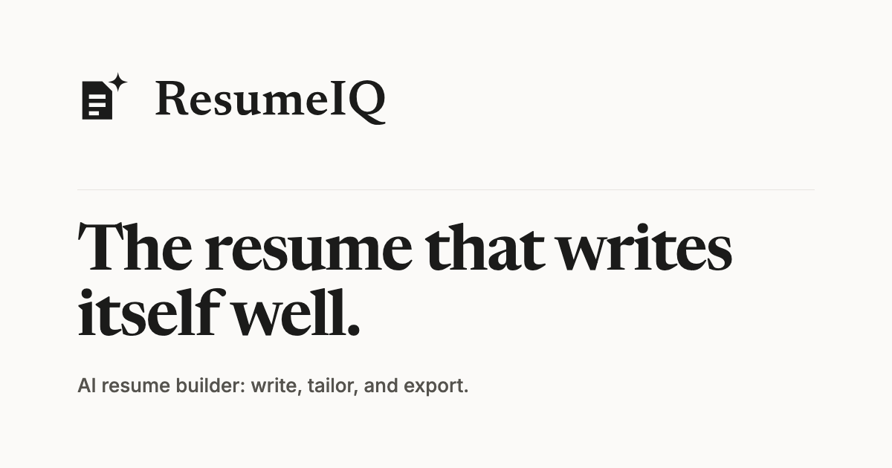

# ResumeIQ

[](https://github.com/musicteachj/smart-resume-builder/actions/workflows/ci.yml)
[](https://github.com/musicteachj/smart-resume-builder/actions/workflows/codeql.yml)

ResumeIQ is an AI resume builder. Import an existing resume or start fresh, edit it in a split-screen
editor with live preview, sharpen bullets, tailor it to any job description with Claude, write a matching
cover letter, and export a clean, ATS-safe PDF, Word document, or plain-text file.

**Live:** https://resume.jameslittlefield.net *(after deploy)*



## Features

**Editor**
- Split-screen editor: structured form on the left, live document preview on the right, debounced autosave
- Drag to reorder sections, entries (experience, education, projects), and individual bullets
- Version history: automatic checkpoints before each editing session, named saves, preview, and undoable restore
- Multiple resumes per account, with duplicate and delete from the dashboard
- Light and dark mode for the app (the resume and its exports always stay light)

**AI assist (Claude)**
- Import an existing resume from PDF, DOCX, or pasted text; review the parsed result before it's created
- Improve individual bullets and generate a professional summary
- Tailor to a job description: ATS match score, missing keywords, and suggested edits, then apply them in place
  or save a tailored copy
- ATS health check: score the resume on its own (no job description) with a list of fixes
- Cover letters: generate from a job description, edit, save several per resume, and regenerate later

**Templates and export**
- Six ATS-safe templates (Classic, Modern, Banner, Executive, Minimal, Editorial) in a visual gallery with live previews
- Six document fonts (Georgia, Times New Roman, Garamond, Arial, Helvetica, Calibri), chosen per resume
- Export to PDF (identical to the preview), DOCX, or plain text

**Accounts and cost protection**
- Email and password sign-in (Google sign-in planned)
- Per-user AI usage tracking with daily and monthly limits (10 and 50 calls)

## Tech stack

| Layer | Tech |
|---|---|
| Frontend | React 19, Vite, TypeScript (strict), Tailwind CSS, shadcn/ui-style components, TanStack Query, React Hook Form + Zod, Zustand, dnd-kit |
| API client | Orval: a typed axios + TanStack Query client generated from the backend's OpenAPI schema |
| Backend | Django 5.2, Django REST Framework, SimpleJWT, drf-spectacular (OpenAPI) |
| Database | PostgreSQL 15 (Docker locally, AWS RDS in production) |
| AI | Anthropic Claude via the Python SDK: Haiku for quick edits, Sonnet for tailoring, parsing, and cover letters |
| CI | GitHub Actions (lint, typecheck, tests, schema drift, Docker smoke test, dependency audit) and CodeQL |
| Hosting | One Docker image (gunicorn serves the API and the built SPA) on AWS ECS Fargate behind an ALB, with ECR, RDS, Secrets Manager, and Route 53 |

## Repository layout

```
client/              React + Vite + Tailwind frontend
server/              Django + DRF API (apps: accounts, resumes, ai)
docs/                DESIGN.md (design system), design/ (logo and brand assets)
screens/             High-fidelity design mockups (visual reference)
.github/workflows/   CI and CodeQL
Dockerfile           Multi-stage production image (Node builds the SPA, Python serves it)
PLAN.md              Implementation plan
CHANGELOG.md         Version-by-version change history
```

## Local development

Prereqs: Node 22 (see `.nvmrc`), Python 3.12, Docker.

```bash
# 1. Install everything (root + client deps, server venv from the hashed lock file)
npm run install:all

# 2. Environment
cp .env.example .env   # keeps DEBUG=True, which local dev requires

# 3. Start Postgres
docker compose up -d

# 4. Migrate
server/.venv/bin/python server/manage.py migrate

# 5. Run client (5173) + server (8000) together
npm run dev
```

- App: http://localhost:5173
- API: http://localhost:8000 (Swagger UI at `/api/schema/swagger-ui/`, health check at `/health`)

Settings are fail-closed: without `DEBUG=True` in `.env`, Django runs in production mode. AI features need an
`ANTHROPIC_API_KEY` in `.env`; without one, the rest of the app works and AI requests return a friendly error.
Usage limits don't apply while `DEBUG` is on. In production, an account gets unlimited AI calls only through
`server/.venv/bin/python server/manage.py set_admin <email>`.

### Run the production image locally

```bash
docker compose --profile prod up --build app   # API + built SPA on http://localhost:8000
```

## Scripts (root)

| Command | What it does |
|---|---|
| `npm run install:all` | Root + client npm deps, server venv + pip |
| `npm run dev` | Client + server concurrently (Vite proxies `/api` to Django) |
| `npm run build` | Production client build |
| `npm run test` | Client (Vitest) + server (pytest) tests; `test:client` / `test:server` run one side |
| `npm run lint` / `npm run typecheck` | Client lint / TypeScript check |

After any backend API change, regenerate the typed client with `npm run gen:api` in `client/`. CI fails if the
committed client differs from a fresh generation.

## Security

- Access tokens live in memory only; the refresh token is an `httpOnly` cookie with rotation and revocation on logout
- Login and registration are throttled, and resume and cover-letter writes are rate-limited per user
- Production sends a strict Content Security Policy, HTTPS redirects, and HSTS
- All resume content is rendered through React's escaping, and resume links only become clickable for `http(s)` URLs

## Design

The UI follows the **"Editorial Ink"** design system: Newsreader + Inter, a reserved forest-green accent on warm
paper, hairline borders, engineered restraint. See [`docs/DESIGN.md`](docs/DESIGN.md) (source of truth) and
`screens/` (visual reference mockups). Logo and brand assets are in [`docs/design/logo/`](docs/design/logo/).
